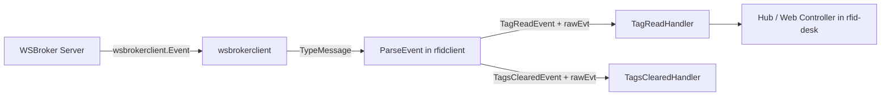
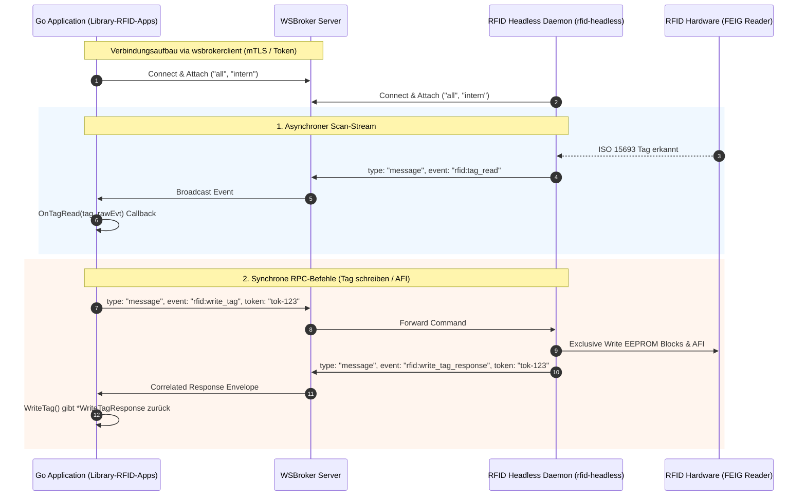

# Library-RFID-Apps - RFID Client Library (Go)

High-performance, modular Go client library for communicating with `rfid-headless` RFID reader/writer daemons over **WSBroker** using `wsbrokerclient`.

---

## Inhaltsübersicht

1. [Überblick & Nutzen](#überblick--nutzen)
2. [Architektur](#architektur)
3. [Installation & Einbindung](#installation--einbindung)
4. [Schnellstart & Code-Beispiele](#schnellstart--code-beispiele)
   - [Initialisierung & Verbindung](#1-initialisierung--verbindung)
   - [Scans empfangen (Tag Read Events)](#2-scans-empfangen-tag-read-events)
   - [Reader-Metadaten & Diagnose abfragen](#3-reader-metadaten--diagnose-abfragen)
   - [RFID-Tag beschreiben (ISO 28560-2)](#4-rfid-tag-beschreiben-iso-28560-2)
   - [AFI-Byte schreiben / Sicherheitstoggle (EAS)](#5-afi-byte-schreiben--sicherheitstoggle-eas)
   - [Channel-Streaming (`SubscribeTags`)](#6-channel-streaming-subscribetags)
   - [Integration in bestehende Controller (`HandleEvent`)](#7-integration-in-bestehende-controller-handleevent)
5. [Alma RFID SOAP Service (`/TagService`)](#alma-rfid-soap-service-tagservice)
6. [Datenstrukturen & Events](#datenstrukturen--events)
7. [Sicherheit & mTLS (MiniVault)](#sicherheit--mtls-minivault)

---

## Überblick & Nutzen

Diese Client-Bibliothek ermöglicht es nachgelagerten Go-Anwendungen (z. B. Verbuchungsstationen, Selbstverbuchern, Rückgabeautomaten, Inventur-Apps und Display-Controllern), zuverlässig und typsicher mit RFID-Lesegeräten (`rfid-headless`) zu kommunizieren:

* **Ereignisgesteuerte Scan-Erkennung**: Empfang und automatische Deserialisierung von ISO 15693 / ISO 28560-2 Tags (`rfid:tag_read`) sowie Entleerungs-Events (`rfid:tags_cleared`).
* **Synchrone RPC-Befehle mit Token-Korrelation**: Deterministisches Ausführen von Befehlen wie Geräteabfragen (`GetDeviceMetadata`), Tag-Schreiboperationen (`WriteTag`) und AFI-Sicherheitsbyte-Modifikationen (`WriteAFI`).
* **Robuste Ausfallsicherheit**: Automatische Wiederverbindung, flexible Channel-Abonnements (`all`, `intern`, station-spezifisch) und umfassendes Alias-Handling für diverse Transponder-Typen und Treiber.
* **Nahtlose wsbrokerclient-Integration**: Baut direkt auf `github.com/je4/wsbrokerclient` auf und nutzt dessen erprobte WebSocket- und mTLS-Infrastruktur.

---

## Architektur

### Zweischichtiges Event-Modell

Die Event-Verarbeitung folgt einer klaren zweischichtigen Architektur, die generische Netzwerk-Infrastruktur von der RFID-Fachdomäne trennt:

1. **Transport-Schicht (`wsbrokerclient.Event`)**: Generischer Umschlag (Envelope) für WebSocket-Publish/Subscribe und RPC (`Source`, `Target`, `Channel`, `Data []byte`, `Timestamp`).
2. **Fach- und Domänenschicht (`pkg/rfidclient`)**: Typisierte Datenstrukturen (`TagReadEvent`, `TagsClearedEvent`, `WriteTagResponse`, `WriteAFIResponse`), die `BaseRFIDPayload` einbetten. Sie kapseln ISO-28560-2-Bibliotheksstandards, AFI-Sicherheitslogik und hardwarebezogene Reader-Zuordnungen.



### Handler-Signatur mit Doppel-Umschlag (Dual-Argument)

Alle Event-Listener (`OnTagRead`, `OnTagsCleared`, `OnWriteTagResponse`, `OnWriteAFIResponse`) stellen sowohl das typisierte Fachmodell als auch das rohe Transport-Envelope bereit:

```go
type TagReadHandler func(tag *TagReadEvent, rawEvt *wsbrokerclient.Event)
```

Konsumenten profitieren von sofortiger Typsicherheit und fachlichen Hilfsmethoden (`tag.IsSecured()`, `tag.IsCRCValidStatus()`), können aber bei Bedarf direkt auf Transport-Metadaten (`rawEvt.Source`, `rawEvt.Channel`) zugreifen.

### Ablaufdiagramm



---

## Installation & Einbindung

Modul in der Go-Anwendung importieren:

```go
import (
    rfidclient "github.com/je4/Library-RFID-Apps/pkg/rfidclient"
    "github.com/je4/wsbrokerclient"
)
```

Oder direkt über das Root-Package:

```go
import (
    rfidapps "github.com/je4/Library-RFID-Apps"
)
```

---

## Schnellstart & Code-Beispiele

### 1. Initialisierung & Verbindung

```go
package main

import (
    "context"
    "log"
    "time"

    rfidclient "github.com/je4/Library-RFID-Apps/pkg/rfidclient"
    "github.com/je4/wsbrokerclient"
)

func main() {
    ctx, cancel := context.WithCancel(context.Background())
    defer cancel()

    // 1. WSBroker-Konfiguration definieren
    brokerCfg := wsbrokerclient.DefaultConfig()
    brokerCfg.Endpoint = "wss://localhost:8765"
    brokerCfg.ClientName = "checkout-station-01"
    brokerCfg.InitialChannels = []string{"all", "intern"}

    // 2. RFID Client erstellen
    client, err := rfidclient.NewFromConfig(brokerCfg,
        rfidclient.WithDefaultTarget("rfid-reader-station-01"),
        rfidclient.WithDefaultTimeout(10*time.Second),
    )
    if err != nil {
        log.Fatalf("Fehler beim Erstellen des RFID-Clients: %v", err)
    }
    defer client.Close()

    // 3. Verbindung herstellen
    if err := client.ConnectSync(ctx); err != nil {
        log.Fatalf("Verbindungsfehler: %v", err)
    }
    log.Println("Erfolgreich mit WSBroker verbunden")
}
```

---

### 2. Scans empfangen (Tag Read Events)

```go
// Listener für erkannte RFID-Medien
client.OnTagRead(func(tag *rfidclient.TagReadEvent, evt *wsbrokerclient.Event) {
    log.Printf("[SCAN] Item-ID: %s | UID: %s | ISIL: %s | CRC-Gültig: %v",
        tag.ItemID, tag.UID, tag.ISIL, tag.IsCRCValidStatus())

    if tag.IsMultiPart() {
        log.Printf("  -> Mehrteiliges Medium: Teil %d von %d",
            tag.GetPartNo(), tag.GetParts())
    }
})

// Listener für leeres Lesefeld (alle Medien entfernt)
client.OnTagsCleared(func(cleared *rfidclient.TagsClearedEvent, evt *wsbrokerclient.Event) {
    log.Println("[INFO] Alle Medien aus dem Lesefeld entfernt.")
})
```

---

### 3. Reader-Metadaten & Diagnose abfragen

```go
ctx, cancel := context.WithTimeout(context.Background(), 5*time.Second)
defer cancel()

// Sendet rfid:get_device_metadata an den Standard- oder Ziel-Reader
meta, err := client.GetDeviceMetadata(ctx, "rfid-reader-station-01")
if err != nil {
    log.Fatalf("Metadatenabfrage fehlgeschlagen: %v", err)
}

log.Printf("Reader ID: %s | Typ: %s | Status: %s",
    meta.DeviceID, meta.DeviceType, meta.Status)
log.Printf("Initialisierungsbericht:\n%s", meta.GetDescription())
```

---

### 4. RFID-Tag beschreiben (ISO 28560-2)

```go
ctx, cancel := context.WithTimeout(context.Background(), 10*time.Second)
defer cancel()

// Schreibauftrag vorbereiten
writeReq := rfidclient.NewWriteTagRequest("3012345678", "E004015099887766")
writeReq.ISIL = "CH-000001-1"
writeReq.Country = "CH"
writeReq.Parts = 1
writeReq.PartNo = 1
writeReq.AFI = "07" // Optional: AFI direkt mitschreiben

// Schreibbefehl ausführen
resp, err := client.WriteTag(ctx, "rfid-reader-station-01", writeReq)
if err != nil {
    log.Fatalf("Kommunikationsfehler: %v", err)
}

if resp.IsSuccess() {
    log.Printf("Tag erfolgreich programmiert: UID=%s, ItemID=%s", resp.UID, resp.ItemID)
} else {
    log.Printf("Schreibfehler: %s", resp.GetError())
}
```

---

### 5. AFI-Byte schreiben / Sicherheitstoggle (EAS)

Die Bibliothek stellt typisierte Konstanten und Hilfsmethoden für den ISO 28560 Sicherheitsstatus bereit:
* `rfidclient.AFISecured` (`"07"`): Medium in der Bibliothek / EAS aktiv (**Gesichert**).
* `rfidclient.AFIUnsecured` / `rfidclient.AFIUnlocked` (`"C2"`): Medium ausgeliehen / EAS deaktiviert (**Entsichert**).

```go
ctx, cancel := context.WithTimeout(context.Background(), 5*time.Second)
defer cancel()

// Option A: Bequeme Hilfsmethoden für Gesichert / Entsichert
resp, err := client.SecureTag(ctx, "rfid-reader-station-01", "E004015099887766")   // setzt "07"
// oder
resp, err = client.UnsecureTag(ctx, "rfid-reader-station-01", "E004015099887766") // setzt "C2"

// Option B: Direkter AFI-Wert mit Konstanten
resp, err = client.WriteAFIValue(ctx, "rfid-reader-station-01", "E004015099887766", rfidclient.AFIUnsecured)
if err != nil {
    log.Fatalf("AFI-Befehl fehlgeschlagen: %v", err)
}

if resp.IsSuccess() {
    log.Printf("AFI erfolgreich auf '%s' (%s) gesetzt für UID %s", resp.AFI, resp.SecurityStatus(), resp.UID)
} else {
    log.Printf("AFI-Schreibfehler: %s", resp.GetError())
}

// Statusprüfung am TagReadEvent:
if tag.IsSecured() {
    log.Println("Transponder ist gesichert (07)")
} else if tag.IsUnsecured() {
    log.Println("Transponder ist entsichert (C2)")
}
```

---

### 6. Channel-Streaming (`SubscribeTags`)

Für Go-Pipelines, die direkt mit Go-Channels arbeiten möchten:

```go
ctx, cancel := context.WithCancel(context.Background())
defer cancel()

tagStream, unsub, err := client.SubscribeTags(ctx, "intern")
if err != nil {
    log.Fatalf("Fehler beim Abonnieren: %v", err)
}
defer unsub()

go func() {
    for tag := range tagStream {
        log.Printf("Stream empfangen: %s", tag.Summary())
    }
}()
```

---

### 7. Integration in bestehende Controller (`HandleEvent`)

Falls eine Anwendung bereits Roh-Events von `wsbrokerclient` oder `wsbrokerdisplay` empfängt:

```go
func OnIncomingRawEvent(rawEvt *wsbrokerclient.Event) error {
    parsed, err := client.HandleEvent(rawEvt)
    if err != nil {
        return err
    }

    switch v := parsed.(type) {
    case *rfidclient.TagReadEvent:
        log.Printf("Verarbeite Tag: %s", v.ItemID)
    case *rfidclient.TagsClearedEvent:
        log.Println("Feld frei")
    case *rfidclient.WriteTagResponse:
        log.Printf("Schreib-Rückmeldung: %s", v.Status)
    }
    return nil
}
```

---

## Alma RFID SOAP Service (`/TagService`)

Für die direkte Integration mit dem **Ex Libris Alma Bibliotheksmanagementsystem** stellt die Webanwendung einen vollständigen, standardkonformen SOAP-1.1-Endpunkt unter `/TagService` bereit.

* **WSDL-Definition**: Abrufbar über `GET /TagService?wsdl`
* **CORS-Unterstützung**: Vollständige Unterstützung von Preflight-Requests (`OPTIONS`) und CORS-Headern (inklusive `SOAPAction`) für Browser- und CloudApp-Anfragen aus Alma.
* **GetTag & GetItems (3M 896 / Bibliotheca)**:
  * Liest das aktuell auf der Antenne liegende Medium aus dem `Hub`.
  * Unterstützt sowohl `GetTag` als auch das von Alma für 3M896 verwendete `GetItems` (`GetDetectedItems`).
  * Antwortet mit `Success`, `ItemIdentifier` (Barcode / Mediennummer) und `SecurityStatus` (`Protected` bei AFI `07`, `Unprotected` bei AFI `C2`, oder `Undefined`).
* **WriteTag & WriteItems**:
  * Schreibt/toggelt das AFI-Sicherheitsbyte synchron über `WriteAFI` (z. B. bei Ausleihe `Unprotected` &rarr; AFI `C2`, bei Rückgabe `Protected` &rarr; AFI `07`).
  * Unterstützt das Neu-Etikettieren / Überschreiben von Mediennummern und AFI über `WriteTag` bzw. `WriteItems`.
* **Channel-Scoping**: Neben dem globalen Endpunkt `/TagService` kann auch kanalspezifisch unter `/:channel/TagService` gearbeitet werden (z. B. `/rfid/TagService`).

---

## Datenstrukturen & Events

### Ereignis- und Antwort-Typen

| Event Identifier | Struct | Beschreibung |
| :--- | :--- | :--- |
| `rfid:tag_read` | `TagReadEvent` | Tag erkannt & decodiert (UID, ItemId, ISIL, Land, AFI, CRC, Teile, Rohdaten) |
| `rfid:tags_cleared` | `TagsClearedEvent` | Alle Transponder aus dem Antennenfeld entfernt |
| `rfid:get_device_metadata` | `DeviceMetadataRequest` | Abfragebefehl für Reader-Hardware und Startup-Diagnose |
| `rfid:device_metadata_response` | `DeviceMetadataResponse` | Antwort mit Geräte-ID, Typ und Initialisierungsbericht |
| `rfid:write_tag` | `WriteTagRequest` | Befehl zum Schreiben von ISO 28560-2 Metadaten und AFI |
| `rfid:write_tag_response` | `WriteTagResponse` | Statusmeldung des Schreibvorgangs |
| `rfid:write_afi` | `WriteAFIRequest` | Befehl zum Setzen des AFI-Sicherheitsstatus |
| `rfid:write_afi_response` | `WriteAFIResponse` | Statusmeldung des AFI-Schreibvorgangs |

### Rolle von `BaseRFIDPayload`

Alle Event- und Response-Modelle betten `BaseRFIDPayload` ein:

```go
type BaseRFIDPayload struct {
    Event     string `json:"event"`
    ID        string `json:"id,omitempty"`
    RefID     string `json:"refId,omitempty"`
    Session   string `json:"session,omitempty"`
    Timestamp int64  `json:"timestamp,omitempty"`
    ReaderID  string `json:"readerId,omitempty"`
    Source    string `json:"source,omitempty"`
    Channel   string `json:"channel,omitempty"`
}
```

* **JSON-Nutzdaten-Mapping**: Ermöglicht direkte Deserialisierung aus `wsbrokerclient.Event.Data`.
* **Hardware- & Domänen-Semantik**: Kapselt physische Reader- und Hardware-Attribute (`ReaderID`, `Session`, `Timestamp`), getrennt von Broker-Routingfeldern (`Source`, `Target`).
* **Autarke Domänen-Objekte**: Ermöglicht die Weiterverarbeitung und das Testen ohne zwingende Abhängigkeit zum Transport-Envelope.

---

## Sicherheit & mTLS (MiniVault)

Zur Authentifizierung gegenüber geschützten WSBroker-Instanzen kann `clienttls` bzw. `certloader` über die Standard-Optionen von `wsbrokerclient` konfiguriert werden:

```go
brokerCfg := wsbrokerclient.DefaultConfig()
brokerCfg.Endpoint = "wss://broker.library.internal:8765"
brokerCfg.ClientName = "rfid-terminal-01"

// Zertifikats-Manager / MiniVault Loader einbinden:
// brokerCfg.CertLoader = certLoader

client, err := rfidclient.NewFromConfig(brokerCfg)
```

---

## Lizenz & Copyright

Copyright &copy; 2026 info-age GmbH, Basel. Lizenziert unter der [Apache License, Version 2.0](LICENSE).
