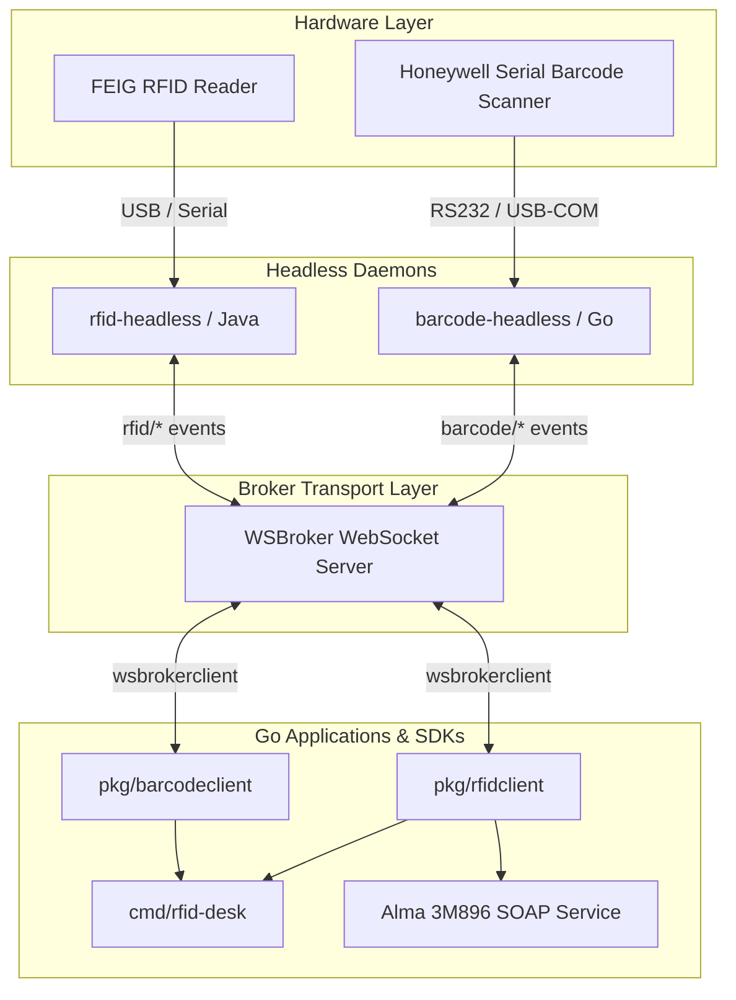

# Library-RFID-Apps

Comprehensive Go ecosystem for RFID and Barcode hardware integration in library automation systems over **WSBroker** using `wsbrokerclient`.

---

## Overview

`Library-RFID-Apps` provides daemons, client SDKs, and workstation applications connecting library hardware (RFID reader/writers and serial Barcode scanners) to automated circulation systems, self-checkout kiosks, return stations, and ILS systems (such as Ex Libris Alma):

- **`cmd/barcode-headless`**: Autonomous background daemon for serial barcode scanners (e.g. Honeywell 1300G-2). Dispatches decoded barcode streams over WebSocket.
- **`cmd/rfid-desk`**: Desktop and web-based workstation application for item check-out, check-in, media labeling, RFID transponder encoding, and Alma 3M896 TagService emulation.
- **`pkg/barcodeclient`**: High-level Go client library for consuming `barcode-headless` scan events and querying scanner diagnostics.
- **`pkg/rfidclient`**: High-level Go client library for communicating with `rfid-headless` daemons (ISO 15693 / ISO 28560-2 RFID tags, AFI security bits, metadata).
- **`pkg/barcodescanner`**: Core serial port driver and event dispatcher engine supporting AIM symbology extraction, debouncing, and auto-reconnection.
- **`pkg/alma`**: Alma 3M896 SOAP TagService integration server.

---

## Architecture & Protocols



### Standardized Event Protocol

All communication between headless daemons and client applications uses a unified, type-safe WebSocket event protocol. Full specifications are available in [docs/events.md](docs/events.md).

#### Barcode Events
| Constant | Wire Event String | Payload | Description |
|---|---|---|---|
| `EventBarcodeRead` | `barcode/read` | `BarcodeReadData` | Asynchronous scan stream |
| `EventGetDeviceMetadata` | `barcode/get_device_metadata` | `DeviceMetadataRequest` | Query scanner status & metrics |
| `EventDeviceMetadataResponse` | `barcode/device_metadata_response` | `DeviceMetadataResponseData` | Diagnostic response |

#### RFID Events
| Constant | Wire Event String | Payload | Description |
|---|---|---|---|
| `EventTagRead` | `rfid/tag_read` | `TagReadData` | ISO 15693 / ISO 28560 tag read |
| `EventTagsCleared` | `rfid/tags_cleared` | `TagsClearedData` | Transponders removed from field |
| `EventGetDeviceMetadata` | `rfid/get_device_metadata` | `DeviceMetadataRequest` | Query reader diagnostics |
| `EventDeviceMetadataResponse` | `rfid/device_metadata_response` | `DeviceMetadataResponseData` | Reader diagnostics response |
| `EventWriteTag` | `rfid/write_tag` | `WriteTagRequest` | Write ISO 28560 blocks & AFI |
| `EventWriteTagResponse` | `rfid/write_tag_response` | `WriteTagResponseData` | Tag write outcome |
| `EventWriteAFI` | `rfid/write_afi` | `WriteAFIRequest` | Toggle AFI (theft / EAS protection) |
| `EventWriteAFIResponse` | `rfid/write_afi_response` | `WriteAFIResponseData` | AFI write outcome |

---

## Installation & Module Usage

```bash
go get github.com/je4/Library-RFID-Apps
```

### RFID Client Usage Example

```go
package main

import (
	"context"
	"fmt"
	"log"

	rfidclient "github.com/je4/Library-RFID-Apps"
	"github.com/je4/wsbrokerclient"
)

func main() {
	cfg := wsbrokerclient.DefaultConfig()
	cfg.Endpoint = "wss://localhost:8080/ws"

	client, err := rfidclient.NewFromConfig(cfg, rfidclient.WithChannels("intern", "all"))
	if err != nil {
		log.Fatal(err)
	}

	client.OnTagRead(func(evt *rfidclient.TagReadEvent) {
		fmt.Printf("RFID Tag Read: ItemID=%s UID=%s Secured=%v\n",
			evt.Data.ItemID, evt.Data.UID, evt.Data.IsSecured())
	})

	if err := client.Connect(context.Background()); err != nil {
		log.Fatal(err)
	}
	defer client.Close()

	select {}
}
```

### Barcode Client Usage Example

```go
package main

import (
	"context"
	"fmt"
	"log"

	"github.com/je4/Library-RFID-Apps/pkg/barcodeclient"
	"github.com/je4/wsbrokerclient"
)

func main() {
	cfg := wsbrokerclient.DefaultConfig()
	cfg.Endpoint = "wss://localhost:8080/ws"

	client, err := barcodeclient.NewFromConfig(cfg, barcodeclient.WithChannels("intern", "all"))
	if err != nil {
		log.Fatal(err)
	}

	client.OnBarcodeRead(func(evt *barcodeclient.BarcodeReadEvent) {
		fmt.Printf("Barcode Scanned: %s (Symbology: %s)\n",
			evt.Data.Barcode, evt.Data.Symbology)
	})

	if err := client.Connect(context.Background()); err != nil {
		log.Fatal(err)
	}
	defer client.Close()

	select {}
}
```

---

## Applications

### 1. `barcode-headless`
Serial barcode scanner daemon. See [docs/barcode-headless.md](docs/barcode-headless.md) for detailed configuration, COM port parameters, AIM prefix stripping, and debouncing setup.

### 2. `rfid-desk`
Circulation desk assistant with web UI, live tag reading, Alma integration, tag encoding, and AFI security toggle. Run via:
```bash
rfid-desk -config config/rfid-desk.toml
```

---

## Testing & Quality Assurance

Run the test suite across all packages:
```bash
go test -v ./...
```

---

## License

This project is licensed under the Apache 2.0 License.
