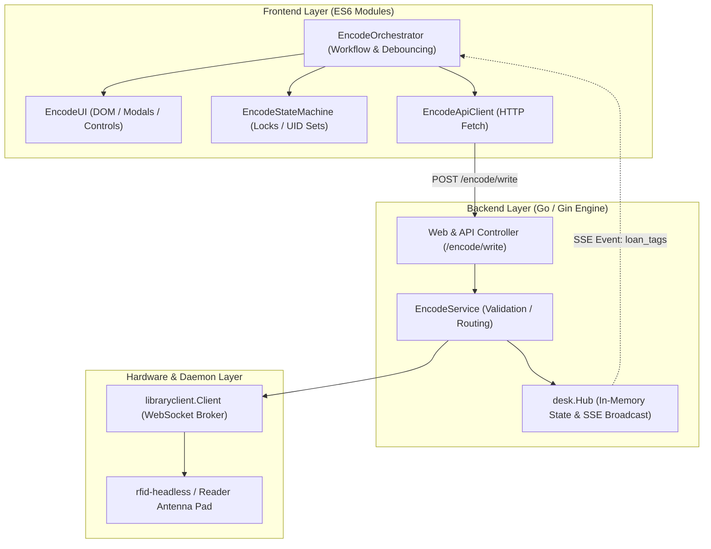
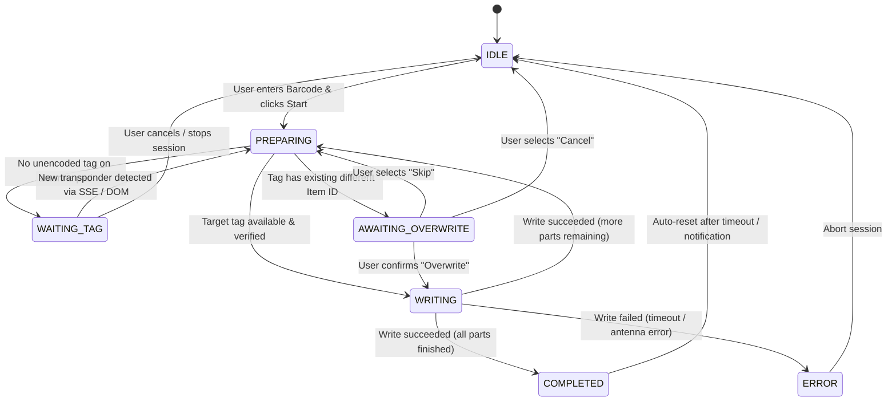
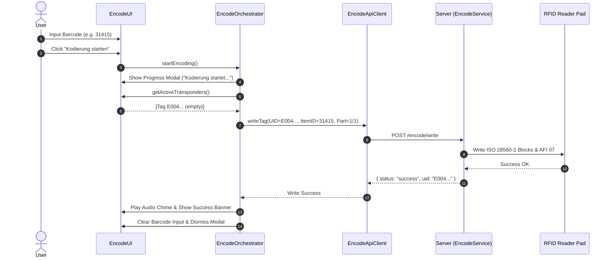
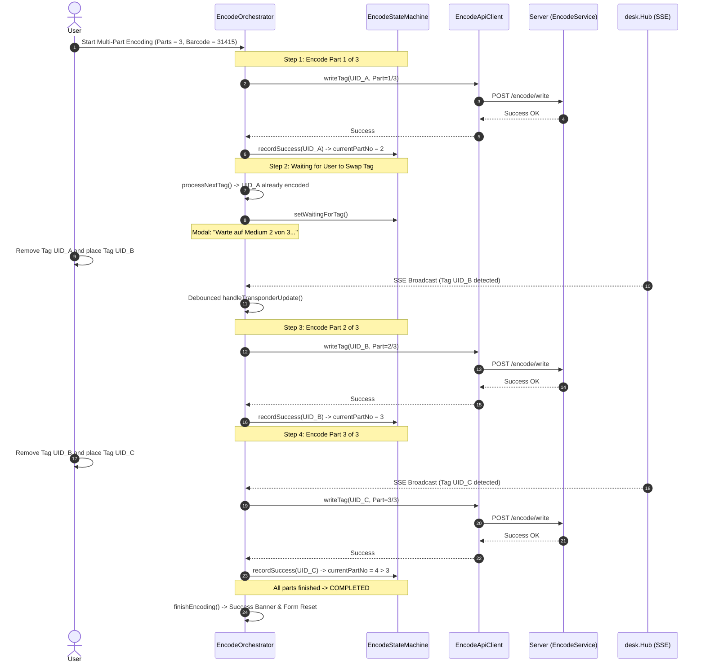
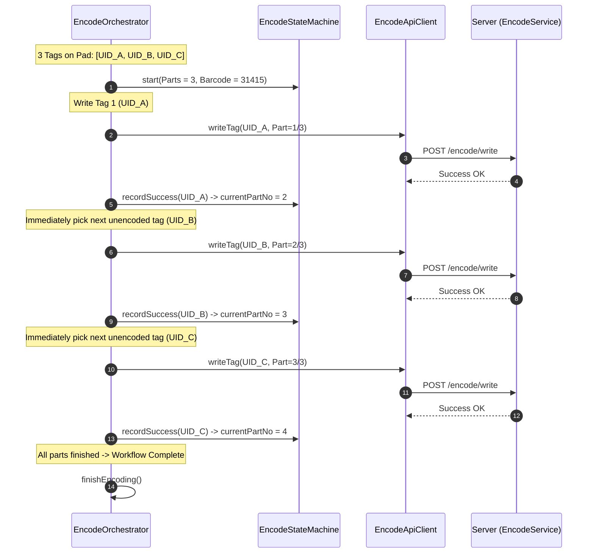
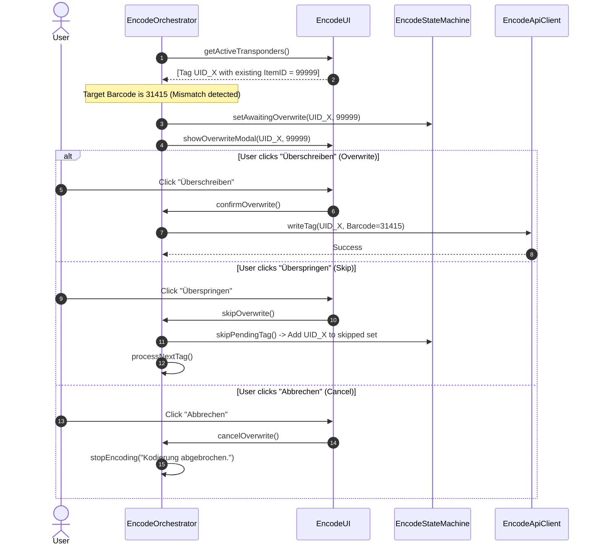
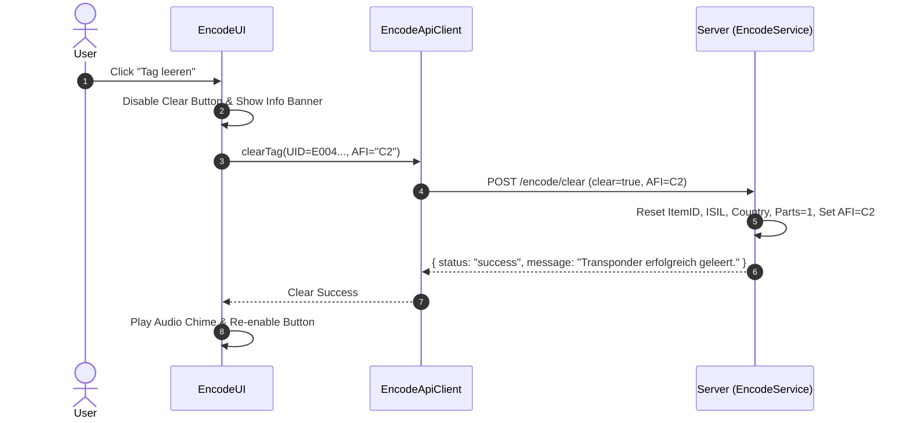

# RFID Transponder Encoding & Multi-Tag Workflows (ISO 28560-2)

This documentation specifies the architecture, state machines, and sequential workflows for encoding ISO 28560-2 compliant RFID library transponders in the **Library Desk** system. The design maximizes encoding throughput and operational reliability while eliminating race conditions and tag collision errors during multi-part and sequential tag operations.

---

### 1. System Overview & Architecture

The encoding subsystem is structured as a distributed, event-driven pipeline comprising three decoupled layers:
1. **Frontend (Browser / ES6 Modules)**: State machine, UI controller, modal lifecycle manager, and debounced HTMX/SSE event listeners.
2. **Backend Server (Go / Gin Engine)**: `EncodeService`, ISO 28560-2 validation engine, reader routing, and in-memory `Hub` synchronization.
3. **RFID Daemon & Hardware**: Transponder communication over ISO 15693 / ISO 28560-2 protocol blocks and AFI security bytes via WebSocket broker.



---

### 2. Module & Class Architecture

#### 2.1 Frontend Modules (`data/web/static/js/modules/encode/`)

* **`encode-state.js` (`EncodeStateMachine`, `EncodeState`)**:
  * Manages formal lifecycle states: `IDLE`, `PREPARING`, `WRITING`, `WAITING_TAG`, `AWAITING_OVERWRITE`, `COMPLETED`, `ERROR`.
  * Enforces mutual exclusion via `isWriteInFlight` and `isBusy()` locks, preventing concurrent duplicate writes.
  * Tracks programmed tags in `encodedUIDs` with normalized (uppercase) strings to avoid case-mismatch re-encoding.
  * Tracks step progress (`currentPartNo` and `totalParts`).
  * Emits structured diagnostic messages via `console.debug`.

* **`encode-api.js` (`EncodeApiClient`)**:
  * Encapsulates asynchronous HTTP endpoints `/encode/write` and `/encode/clear`.
  * Handles JSON serialization, HTTP status codes, performance metrics, and network error recovery.

* **`encode-ui.js` (`EncodeUI`)**:
  * Manages native `<dialog>` modals (Progress/Waiting modal and Overwrite Confirmation modal).
  * Manages status notification banners with auto-dismiss timers.
  * Extracts currently active transponders from the DOM (`getActiveTransponders()`).
  * Synchronizes AFI security status toggle controls (`07` secured vs `C2` unsecured) and multi-part pill/dropdown selectors.

* **`encode-orchestrator.js` (`EncodeOrchestrator`)**:
  * Coordinates UI interactions, API requests, and state machine transitions.
  * Implements debounced listeners (60ms) for SSE `loan_tags` broadcasts, HTMX swaps, and DOM mutations.
  * Controls audio chime triggers via `playBeep()`.

* **`encode-controller.js`**:
  * Serves as the public ES6 facade module integrated by `desk.js`.

#### 2.2 Backend Service (`pkg/web/`)

* **`pkg/web/encode_service.go` (`EncodeService`)**:
  * `ValidateAndNormalize(*WriteTagRequestPayload)`: Validates Item ID presence, normalizes ISIL country prefixes (`CH`), validates part numbers (`1 <= partNo <= parts`), and normalizes AFI hex values.
  * `ResolveTarget(channel, uid)`: Resolves target reader ID and daemon channel from active Hub transponders or fallback defaults.
  * `ExecuteWriteTag(ctx, channel, payload)`: Executes the write command against the RFID daemon, updates Hub in-memory state, and broadcasts real-time UI updates.

---

### 3. State Machine Lifecycle



---

### 4. Sequential Encoding Workflows

#### Workflow 1: Single-Part Item (1/1)



---

#### Workflow 2: Sequential Multi-Part Media (One-by-One Tag Placement)
*Example: 3-part set (Part 1/3, Part 2/3, Part 3/3) where each medium is placed, encoded, removed, and replaced sequentially.*



---

#### Workflow 3: Simultaneous Multi-Tag Placement (Batch on Reader Pad)
*Example: 3 tags are resting simultaneously on the reader antenna pad.*



---

#### Workflow 4: Overwrite Protection Dialog



---

#### Workflow 5: Blanking / Clearing Transponders ("Tag leeren")



---

### 5. Race Condition Elimination & Synchronization Guarantees

1. **In-Flight Write Lock**: `EncodeStateMachine.setWritingInFlight(true)` prevents subsequent triggers while an asynchronous network call is executing.
2. **Debounced Event Processing**: HTMX `afterSwap` events, SSE messages, and DOM `MutationObserver` triggers are debounced to 60ms to prevent rapid-fire redundant executions.
3. **UID Normalization**: All transponder UIDs are normalized (`strings.ToUpper(strings.TrimSpace(uid))`) on both frontend and backend to eliminate case-mismatch bugs.
4. **State Isolation**: When the overwrite modal is open (`AWAITING_OVERWRITE`), external reader scan events cannot dismiss or bypass the user confirmation prompt.

---

### 6. API Reference

#### `POST /:channel/encode/write` and `POST /api/v1/encode/write`
Programs ISO 28560-2 library metadata and AFI security status to a transponder.

**Request Payload**:
```json
{
  "uid": "E0040150E2A12345",
  "itemId": "31415926535",
  "isil": "CH-001596-0",
  "country": "CH",
  "parts": 3,
  "partNo": 1,
  "usageType": 1,
  "afi": "07",
  "clear": false
}
```

**Response Payload**:
```json
{
  "status": "success",
  "message": "Transponder E0040150E2A12345 erfolgreich beschrieben (Teil 1 von 3).",
  "uid": "E0040150E2A12345",
  "itemId": "31415926535",
  "isil": "001596-0",
  "country": "CH",
  "parts": 3,
  "partNo": 1,
  "usageType": 1,
  "afi": "07"
}
```

#### `POST /:channel/encode/clear` and `POST /api/v1/encode/clear`
Clears metadata and resets the AFI byte to unlocked state (`C2`).

**Request Payload**:
```json
{
  "uid": "E0040150E2A12345",
  "clear": true,
  "afi": "C2"
}
```
